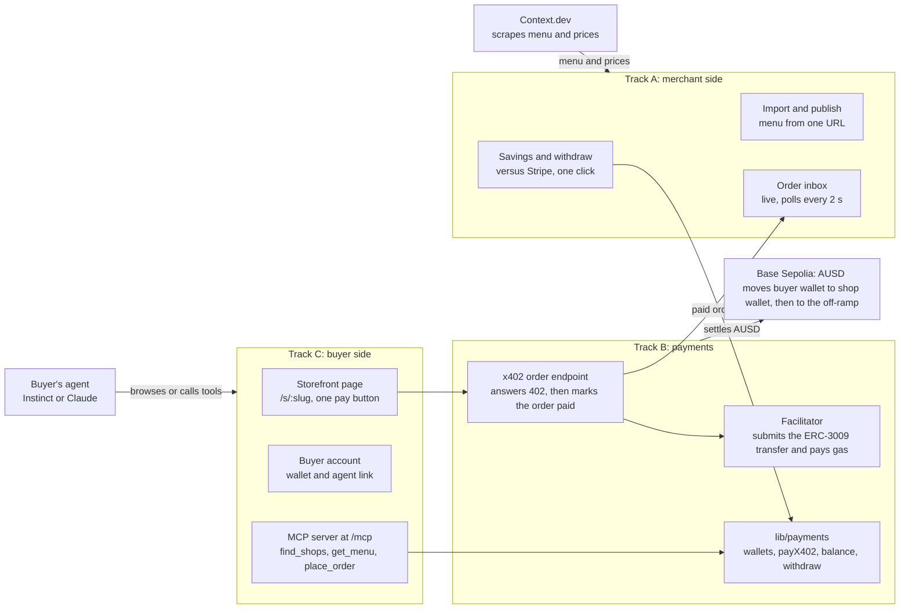

# The Payments build plan

The living version of this plan is the [team doc](https://claude.ai/code/artifact/aa6914b8-8197-48b9-a6a9-fc118e2452c7).

We're building The Payments, a managed storefront that lets a small shop sell to AI agents like Instinct and get paid in AUSD, skipping the card fee on every order. Three teammates build it in parallel against one shared contract.

## Pitch

Small shops lose about 6–9% of a $5 coffee to card fees. When an AI agent places the order and pays over x402 in AUSD, that fee drops to well under a cent.

| How a $5 coffee is paid | Fee | Share of the sale |
| --- | --- | --- |
| Online, Stripe (2.9% + 30¢) | 44.5¢ | 8.9% |
| At the counter, Square (2.6% + 15¢) | 28¢ | 5.6% |
| x402 + AUSD on Base | under 1¢ | ~0% |

What the product does:

- **Onboarding in one step.** A shop owner pastes a link to their site. Context.dev pulls the menu and prices, and we publish a managed storefront that agents can order from.
- **Both sides gain.** The shop keeps the card fee and gets found by agents. It hands part of the saving back as a discount, which beats a 1–2% rewards card, and ordering by texting Instinct is easier than any checkout.
- **One-click weekly withdrawal.** The shop never deals with crypto. It sees dollars, and once a week it withdraws them to its bank.

Walk-in sales stay on cards. We only take the orders an agent places, which in practice means pickup orders.

## Brand and UI

The product is called The Payments, because we want to power all the payments in the world. The name flips The Social Network's line: drop the "Facebook," just "The." It lives at thepayments.vercel.app until we buy a domain.

The look is modern and sleek, with two typefaces:

| Role | Typeface | How we load it |
| --- | --- | --- |
| Display: headings, the shop's savings number | [Syne](https://fonts.google.com/specimen/Syne), variable 400–800 | Google Fonts through `next/font/google` |
| UI and body text | [Cooper Hewitt](https://www.cooperhewitt.org/open-source-at-cooper-hewitt/cooper-hewitt-the-typeface-by-chester-jenkins/) | Not on Google Fonts. Self-host the museum's web font package with `next/font/local`, and commit its OFL license file next to the fonts. |

Both fonts are defined once in the Tailwind theme as `font-display` and `font-sans`, along with the colour tokens. Components use those names and never set a font family themselves.

The main colour is teal #00BCA8 on a white background. On white it only reaches 2.4:1 contrast, so it works as a fill and an accent but never as text. White text on it fails the same way.

| Token | Value | Use | Contrast |
| --- | --- | --- | --- |
| `--accent` | #00BCA8 | Fills, highlights, focus rings, the savings number's mark | 2.4:1 on white, so never text |
| `--accent-ink` | #008577 | Teal text and links on white | 4.54:1 on white |
| `--on-accent` | #0B1F1C | Text on teal buttons and chips | 7.14:1 on #00BCA8 |
| `--surface` | #FFFFFF | Page background | |

## Sponsor tracks

We enter Agora and Context.dev for sure, plus one general track. Ripple and ElevenLabs are stretch goals, and we enter them only if the core works first.

| Track | Prize | What we use | Priority |
| --- | --- | --- | --- |
| General: Most Technically Impressive | $1,250 / $500 | The whole system working end to end on testnet | Required (pick one general track) |
| Best Use of AUSD (Agora) | $1,000 / $500 | x402 payments in AUSD on Base Sepolia, gasless ERC-3009 transfers | Core |
| Best Use of Context.dev | $750 + $5k credits | Pull a shop's menu and prices from one URL | Core |
| Best Use of Ripple | $1,000 / $500 | A second rail: RLUSD over x402 on XRPL testnet, plus escrow for preorders | Stretch |
| Best Use of ElevenLabs | $250 + credits | A voice agent that takes phone orders for the shop and pays through the same storefront | Stretch |
| YZi Labs: Programmable Capital, Intelligence & Science | $1,000 / $500, plus an EASY Residency interview | The whole product. Their idea starters name merchant checkout and agent wallets. The track is open to any chain, and the judging asks whether we'd keep building after today. | Core (no extra build unless they require BNB testnet) |

Gemini (prediction markets) doesn't fit, so we skip it.

## Architecture

Track C hands every payment to Track B's x402 endpoint, and Track B tells Track A when an order is paid. Only Track B talks to Base Sepolia, so the other two tracks can build against stubs until it's ready.

## Shared contract

All three of us agree on these models and endpoints in the first hour, commit them as TypeScript types, and then build against them independently. Until a real endpoint lands, each track works against stubs that return these shapes.

**Stack:** one Next.js app (App Router, TypeScript, Tailwind) on Vercel, with Supabase Postgres for data. Only the server talks to the database, using the secret key. Row-level security is on with no public policies, so the browser never reads tables directly. The chain code lives in `lib/payments`, owned by Track B. The MCP server lives in the same app at /mcp.

**Models** (money is stored in integer cents and converted to token units only inside `lib/payments`):

| Model | Fields |
| --- | --- |
| Shop | id, slug, name, sourceUrl, walletAddress, agentDiscountPct, status (draft, live) |
| Product | id, shopId, name, description, priceCents, imageUrl, available |
| Buyer | id, email, walletAddress |
| Order | id, shopId, buyerId, pickupName, items [{productId, name, qty, unitPriceCents}], subtotalCents, discountCents, totalCents, status (awaiting_payment, paid, ready, picked_up), chain, txHash, createdAt, paidAt |
| Withdrawal | id, shopId, amountCents, txHash, status, createdAt |

**Endpoints:**

| Endpoint | Who calls it | Owner |
| --- | --- | --- |
| `POST /api/shops/import` {url} → draft shop + products | Merchant onboarding page | A |
| `PATCH /api/shops/:slug` edit menu, set discount, publish | Merchant dashboard | A |
| `GET /api/shops` directory of live shops | Buyer site, MCP server | A |
| `GET /api/shops/:slug/menu` public JSON menu with agent prices | Any agent | A |
| `POST /api/shops/:slug/orders` answers 402 with the price, creates a paid order once payment settles | Agents that speak x402 | B |
| `POST /api/buyer/orders` signed-in buyer orders; our server pays from the buyer's wallet over x402 | Buyer site, and Instinct through it | C (calls B's client) |
| `GET /api/orders/:id` status and tx link | Everyone | B |
| `GET /api/shops/:slug/balance` and `POST /api/shops/:slug/withdraw` | Merchant dashboard | B |
| `/mcp`: MCP tools over Streamable HTTP; a browser gets a page explaining how to connect | Claude, Cursor, any MCP client | C |

Shop edits need the shop's admin token in the `x-shop-token` header. The token is created at import and lives in `shop_secrets`, which nothing public can read.

`lib/payments` exports `createWallet()`, `getBalance(shop)`, `payX402(buyerWallet, url, body)`, `withdraw(shop, amount)` and `explorerUrl(txHash)`. Tracks A and C only ever call these, never the chain directly.

## Track A: merchant side

Track A owns everything the shop owner sees: import from a URL, review the menu, publish, watch orders arrive, see what they saved, and withdraw. It also owns the public menu and directory endpoints.

- [ ] **Import.** `POST /api/shops/import` calls Context.dev's scrape and structured-extract endpoints with a JSON schema for menu items (name, description, price, image). It saves a draft shop and its products. When a site has no prices, the import says so instead of guessing.
- [ ] **Review and publish.** An editable menu table where the owner fixes names and prices, sets the agent discount (default 5%), and publishes. Publishing creates the shop's wallet through `lib/payments.createWallet()`.
- [ ] **Order inbox.** A live list of paid orders that polls every 2 seconds, with a sound and a big "new order" state, so a barista can leave it open on a tablet. Buttons move an order to ready, then picked up. Without this, the shop never learns an agent ordered.
- [ ] **Savings panel.** This week's sales, what Stripe and Square would have charged for the same orders, and the difference. It's computed from real orders, not hard-coded.
- [ ] **Withdraw.** A one-click button that calls `withdraw()`, then shows the amount, the transaction link and the bank step (see the demo section for what is stubbed).
- [ ] **Public endpoints.** `GET /api/shops` and `GET /api/shops/:slug/menu`, with agent prices already discounted.

**Done when** pasting a real café's URL (Ladle & Leaf's) produces a live storefront in under a minute, and a paid test order shows up in the inbox without a page refresh.

Crawling a whole site costs Context.dev credits, and the free tier is reportedly 500. Cache every import response, and point the scraper at the menu page rather than the whole domain.

## Track B: payments and chain

Track B owns `lib/payments` and the x402-protected order endpoint, so it's the only track that touches the chain. Start with the riskiest question: will an x402 facilitator settle AUSD on Base Sepolia?

- [ ] **Facilitator decision (first hour).** A facilitator is the service that checks a signed x402 payment and submits it on chain. Check with the Agora docs MCP and the Agora table whether a hosted facilitator accepts AUSD on Base Sepolia. If none does, run the open-source facilitator ourselves. It calls AUSD's `transferWithAuthorization` (ERC-3009) and pays the gas from a Base Sepolia ETH account we fund.
- [ ] **Token details.** Get AUSD's Base Sepolia contract address, decimals and EIP-712 domain (name and version) from Agora's deployments page. A wrong domain makes every signature fail without a clear error.
- [ ] **402 endpoint.** `POST /api/shops/:slug/orders` prices the order from the database, then answers 402 with the `exact` scheme, network `base-sepolia`, the AUSD address, the amount, and `payTo` set to the shop's wallet. When the retry carries a valid payment, it settles, marks the order paid with its `txHash`, and returns the order.
- [ ] **Idempotency.** Key settlement on the authorization nonce, so a retried request can't pay twice or create two orders.
- [ ] **`payX402()` client.** It requests, reads the 402, signs the ERC-3009 authorization with the buyer's key, retries with the payment header, and returns the order and transaction. Both Track C's server path and its MCP server use it.
- [ ] **Wallets.** `createWallet()` generates a keypair and stores the key encrypted. This is testnet only. In production, shops own their wallets (an embedded or passkey wallet) so we never hold funds. Be ready to say this when judges ask.
- [ ] **Funding.** Mint AUSD by hand from Agora's faucet into one treasury wallet. `fundBuyer()` then sends demo AUSD from it to new buyer wallets.
- [ ] **Balance and withdraw.** `getBalance()` reads the shop's balance from the chain, not a database sum. `withdraw()` sends it to an off-ramp address and records a Withdrawal.
- [ ] **Stretch: XRPL rail.** The same endpoint also accepts RLUSD over x402 on XRPL testnet (XRPL's x402 docs and xrpl.js). Preorders lock the payment in an XRPL escrow that's released when the shop marks the order picked up. This is what makes the Ripple track credible.

**Done when** a script pays a live shop over x402, the transfer shows on the Base Sepolia block explorer, and the order flips to paid.

## Track C: buyer side and agents

Track C owns how buyers and their agents find a shop and pay. Instinct doesn't have a public API. It drives its own browser and signs in with credentials you give it, so the storefront has to work as a plain web page, not only as an API.

- [ ] **Buyer account.** Sign up with email and password. That creates a wallet (`createWallet()`) and funds it with demo AUSD (`fundBuyer()`). The account page shows the balance, past orders, and the total saved versus card prices.
- [ ] **Agent link.** Each buyer gets a secret link that signs an agent into their account with permission to place orders and nothing else. You text the link to Instinct once, which beats handing over your password.
- [ ] **Storefront page `/s/:slug`.** Server-rendered, semantic HTML that a browser agent can read without running scripts: menu items, quantities, a pickup name, and one button, "Pay $4.75 from wallet." The button posts to `POST /api/buyer/orders`, which calls `payX402()` from the buyer's wallet. The confirmation page shows the order number, the card fee the shop avoided, and the transaction link.
- [ ] **Agent discovery.** A `/shops` directory, plus an `llms.txt` and a JSON menu link in each storefront's head, so any agent can find shops and prices without scraping.
- [ ] **MCP server.** It's served from /mcp on the main site through Vercel's mcp-handler. A browser that opens /mcp gets a page listing the tools and how to connect, while MCP clients get the protocol. It has three tools: `find_shops`, `get_menu` and `place_order`. `place_order` pays over x402 with a wallet set in an environment variable. It's the backup demo, Claude ordering the same coffee, and it shows that agents other than Instinct can use us.
- [ ] **Stretch: ElevenLabs phone line.** A voice agent answers the shop's number, takes the order, and charges the caller's wallet, which it finds by their phone number. It goes through the same order endpoint.

**Done when** a text to Instinct (or a Claude prompt, as the backup) orders a latte from the demo Ladle & Leaf storefront, and the order shows up paid in Track A's inbox.

## Demo with Instinct

The payment in the demo is real: real AUSD moves on Base Sepolia, which is a test network. It goes to a wallet we create for a stand-in Ladle & Leaf storefront, built from their real website. The actual shop never gets the money, because it's test money in a wallet they don't own. We label the storefront "demo, not affiliated" on screen.

| Part of the demo | What happens | Real or stubbed |
| --- | --- | --- |
| Menu import | A live Context.dev call on Ladle & Leaf's real site | Real |
| Instinct order | A text to Instinct, which opens the storefront and taps pay | Real, if someone on the team has an Instinct invite |
| Payment | An AUSD transfer on Base Sepolia, visible on the block explorer | Real, with test money |
| Shop wallet | A wallet we generated for the demo shop | Stand-in for the shop's own |
| Savings panel | Calculated from the orders actually placed | Real |
| Weekly withdrawal | The on-chain transfer to an off-ramp address is real. The bank deposit after it is a labeled stub. | Half stubbed, and we say so |

The 2-minute video:

1. **The problem (10 s).** A $5 coffee at Ladle & Leaf loses 28–45¢ to card fees.
2. **Onboarding (25 s).** Paste Ladle & Leaf's URL. The menu fills in, set a 5% agent discount, publish.
3. **The order (35 s).** On a phone, text Instinct: "Get me an oat latte from Ladle & Leaf, pickup under Boris." Cut to Instinct's reply confirming it paid.
4. **The shop side (20 s).** The tablet inbox lights up with the order. Click through to the AUSD transfer on the block explorer.
5. **Money (20 s).** The savings panel compares this week to Stripe. Click withdraw and the transfer shows up.
6. **Close (10 s).** Any agent can order through the MCP server, and any shop can join with one link.

Instinct is slow and unpredictable, so record its part first and keep several takes. If no one has an invite, the same flow runs with Claude through our MCP server.

## Admin

One person handles setup in the first 30 minutes, so the three tracks can start on a scaffold that already deploys.

**Setup**

- [ ] Scaffold the Next.js app in `babhacks2`, push it, and make the repo public. The submission requires a public repo.
- [ ] Create the Vercel project and the Supabase project. Put every key in Vercel's environment variables and a local `.env`, and never commit them.
- [ ] Commit the shared contract types before anyone writes a feature.
- [ ] Install the coding-agent tools on every machine: the Agora docs MCP (`claude mcp add --transport http agora https://docs.agora.finance/_mcp/server`) and the Context.dev skill (`npx skills add https://docs.context.dev --skill context-dev --yes`). Add the XRPL MCP (`https://xrpl.org/mcp`) if we go for the Ripple stretch.
- [ ] Go to the Cursor workshop to redeem the team's credits.

**Accounts and funds**

- [ ] Context.dev API key.
- [ ] Base Sepolia ETH from a faucet for the treasury and the facilitator (it pays gas).
- [ ] Testnet AUSD from Agora's faucet (10,000 per request) into the treasury wallet.
- [ ] An Instinct invite on someone's phone. Find out today, because it decides the demo.
- [ ] Optional: the ElevenLabs coupon through the event Discord, and an XRPL testnet wallet from the faucet.

**Ship**

- [ ] Deploy to Vercel on every merge to main, so the live link always works.
- [ ] Seed the demo: import Ladle & Leaf, publish it, and fund one buyer account.
- [ ] Record the demo video (2 minutes max) and upload it to YouTube.
- [ ] Write the README: the problem, how it works, how to run it, and what's real versus stubbed.
- [ ] Submit at hackathoncompany.com/platform, starting at least 15 minutes before the deadline. Enter Most Technically Impressive, Agora, Context.dev and YZi Labs, plus Ripple and ElevenLabs if the stretches landed.

## Milestones

There are four checkpoints where the tracks meet. Don't start a stretch goal until checkpoint 3 passes.

1. **The contract is frozen.** The types are committed, the scaffold deploys, and every track runs against stubs. Track B has decided on the facilitator.
2. **First real payment.** Track B's script pays a seeded shop on Base Sepolia, and the order flips to paid in the database.
3. **End to end in a browser.** Track A imports Ladle & Leaf. A signed-in buyer on Track C's storefront pays, and the order appears in Track A's inbox without a refresh.
4. **Agents order.** Instinct (or Claude through the MCP server) completes an order from a text message. After this, record the demo, then try the stretches.

## Open questions

- [ ] **Agora table:** Does a hosted x402 facilitator settle AUSD on Base Sepolia, or do we run our own?
- [ ] **Agora table:** Coverage from 2025 said AUSD isn't offered to US persons. What's the answer for a US café, and how would a shop turn AUSD into dollars in its bank?
- [ ] **Team:** Who has an Instinct invite?
- [ ] **Team:** Is anyone willing to ask Ladle & Leaf whether we can use their menu in the demo? It's public, but asking costs nothing and could become a real pilot.
- [ ] **Ripple table (if we stretch):** Is RLUSD available on XRPL testnet, and is there a public x402 facilitator for it?
- [ ] **YZi Labs table:** Does a Base Sepolia deployment count, or do they want BNB testnet? If they want BNB, the x402 code only needs a second network config, plus an ERC-3009 stablecoin on BSC testnet (ask Agora whether AUSD is there).

## Sources

The fee figures come from third-party summaries of Stripe's and Square's list prices. Check the official pricing pages before putting them on a slide.

- [Stripe pricing breakdown 2026 (Flexprice)](https://flexprice.io/blog/stripe-pricing-breakdown-2026)
- [Square fees 2026 (NerdWallet)](https://www.nerdwallet.com/business/software/learn/square-fees)
- [Stripe stablecoin payments docs](https://docs.stripe.com/crypto/stablecoins), which charge 1.5%
- [Stripe adds x402 for agent payments (The Block)](https://www.theblock.co/post/389352/stripe-adds-x402-integration-usdc-agent-payments)
- [Agentic payments with x402 on the XRP Ledger](https://xrpl.org/docs/agents/agentic-payments-x402)
- [XRPL transaction cost](https://xrpl.org/transaction-cost.html)
- [Base network configuration changelog](https://docs.base.org/base-chain/network-information/configuration-changelog)
- [Vercel mcp-handler](https://github.com/vercel/mcp-handler)
- [Instinct AI review (eesel)](https://www.eesel.ai/blog/instinct-ai-review)
- [Context.dev on Product Hunt](https://www.producthunt.com/p/context-dev/context-dev-2)
- [Agora raises $50M (Decrypt)](https://decrypt.co/329634/agora-raises-50-million-power-next-wave-stablecoins)
- [B@BHacks 2.0 tracks and judges](https://app.notion.com/p/B-BHacks-2-0-Tracks-Judges-3f243bcc211c80189a72e1f9b8583a67)
