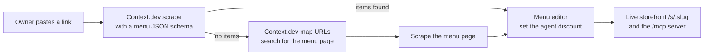
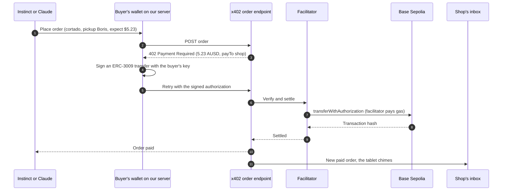
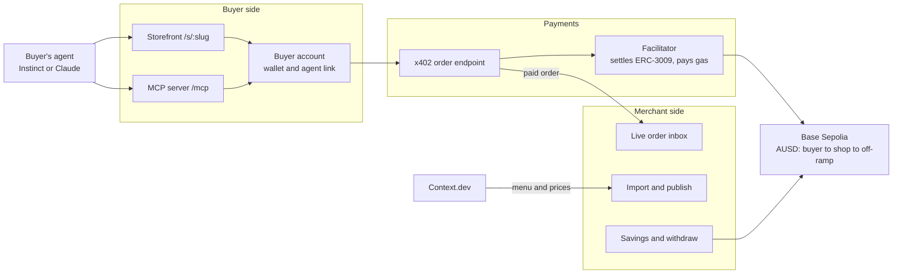

The Payments lets a small shop sell to AI agents and get paid in AUSD over x402, so it keeps the money a card network would have taken. Setting a shop up takes one link to its website.

It won **Best Use of Context.dev** ($750) at the hackathon. Try it at [thepayments.vercel.app](https://thepayments.vercel.app).

We posted about it on LinkedIn [here](https://www.linkedin.com/feed/update/urn:li:activity:7515246718133653504/) and [here](https://www.linkedin.com/feed/update/urn:li:activity:7515571160332460032/).

## Card fees eat a coffee

Mind Coffee on Euclid Ave in Berkeley sells a cortado for $5.50. When someone orders it online, Stripe keeps 46¢ before the shop sees any of it. An agent order through The Payments costs the buyer less and still leaves the shop with more.

| How the $5.50 cortado is paid | Buyer pays | Fee | Shop keeps |
| --- | ---: | ---: | ---: |
| Online through Stripe (2.9% + 30¢) | $5.50 | 46¢ | $5.04 |
| At the counter through Square (2.6% + 15¢) | $5.50 | 29¢ | $5.21 |
| An AI agent through The Payments, 5% agent discount | $5.23 | none | $5.23 |

Every figure comes from [`lib/pricing.ts`](lib/pricing.ts). Our facilitator pays the gas on Base, so the shop receives the whole $5.23.

## How it works

### One link sets up the shop

The owner pastes their ordering page on the home page. [Context.dev](https://context.dev) reads the menu and prices from it, and the items land in the editor. The owner picks an agent discount and publishes a storefront at `/s/<shop>`.

An import costs 1 to 3 Context.dev credits. The first scrape costs about 1 credit. The URL map (2 credits) only runs when the pasted page has no items on it, which happens when a café's home page links out to its menu. [`lib/shops/importMenu.ts`](lib/shops/importMenu.ts) makes that decision, and [`lib/shops/contextDev.ts`](lib/shops/contextDev.ts) retries 408, 429 and 5xx responses with bounded backoff.

### An agent places the order

A customer texts Instinct, their AI assistant: "Get me a cortado from Mind Coffee, pickup under Boris." Instinct opens the storefront through the customer's private agent link and presses "Pay $5.23 from wallet." Claude and other MCP clients can place the same order through the MCP server at `/mcp`, which has three tools: `find_shops`, `get_menu` and `place_order`.

AUSD is Agora's stablecoin, which is always worth one dollar. The payment runs on x402, which puts a price on an ordinary HTTP request.

Agents never see the buyer's private key. The agent link proves which buyer it acts for, and the server signs from that buyer's encrypted wallet. It signs only when the agent's expected total matches the live menu price, the order is under the per-order cap, and the wallet is already funded.

### The shop withdraws once a week

The savings panel adds up what Stripe and Square would have charged on the shop's real orders. Pressing withdraw sends the AUSD on chain to an off-ramp that pays dollars into the shop's bank. The on-chain transfer is real on Base Sepolia. The bank deposit is simulated.

## Architecture

One Next.js app on Vercel holds all three parts, with Supabase Postgres behind it. Only the server reads the database, and only [`lib/payments`](lib/payments) talks to the chain.

| Path | What it is |
| --- | --- |
| [`lib/contract.ts`](lib/contract.ts) | The shared types every part builds against |
| [`lib/shops`](lib/shops) | Context.dev import, menu extraction, the shop repository |
| [`lib/payments`](lib/payments) | Wallets, x402, balance and withdraw. [docs/TRACK_B.md](docs/TRACK_B.md) lists the verified AUSD contract settings. |
| [`lib/buyer`](lib/buyer), [`lib/mcp.ts`](lib/mcp.ts) | Buyer accounts, agent links, approvals and the MCP tools |
| [`lib/pricing.ts`](lib/pricing.ts) | Agent prices and the card-fee math |
| [`components/ui`](components/ui) | Button, Field, Ticket and StatusPill |
| [`app/globals.css`](app/globals.css) | Colour, type, radius and motion tokens |
| [`supabase/migrations`](supabase/migrations) | The database schema, one file per change |
| [`demo`](demo) | The video script and the scripts that cut it |

[PLAN.md](PLAN.md) is the original build plan, written so three of us could build the merchant side, the payments and the buyer side in parallel against one contract.

## Run it locally

1. `npm install`
2. Start a local database with Docker running: `npx supabase start -x gotrue,realtime,storage-api,imgproxy,mailpit,postgres-meta,studio,edge-runtime,logflare,vector,supavisor`. This applies everything in `supabase/migrations`.
3. `cp .env.example .env.local`, then set `SUPABASE_SECRET_KEY` to the secret key that `npx supabase status` prints, and add your `CONTEXT_DEV_API_KEY`.
4. `npm run dev` and open http://localhost:3000.

The command in step 2 leaves out Supabase Auth. To test buyer accounts and agent links, follow [docs/TRACK_C.md](docs/TRACK_C.md). Real testnet checkout stays off until you fill in the payment settings in `.env.example` and set `PAYMENTS_CHECKOUT_ENABLED=true`.

Checks: `npm run lint` (which caps cyclomatic complexity at 15), `npm run typecheck`, `npm test`, and `npm run test:e2e` after a build with Playwright Chromium installed.

## Team

Built by [@borisnezlobin](https://github.com/borisnezlobin), [@azoghby](https://github.com/azoghby) and [@ECunending](https://github.com/ECunending).
